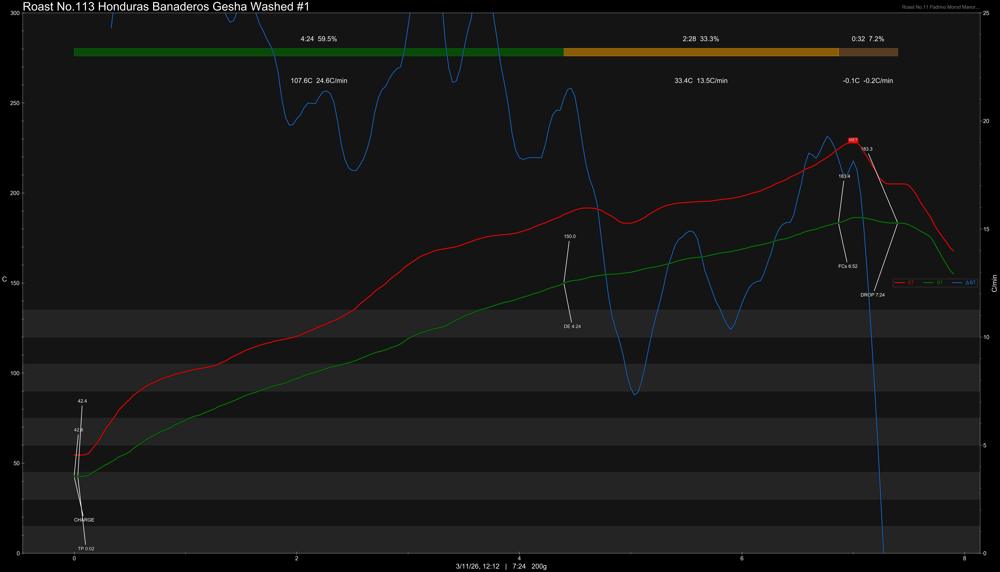

# Honduras Banaderos Gesha Washed

Origin: Honduras

Region: La Paz, Santiago de Puringla

Farm / Station: Banaderos

Producers: Hotilio Hernandez

Varietal: Gesha

Process: Washed

Elevation (MASL): 1750

Stock: 800g

## Importer Information

Green Profile: Jasmine, Cherry, Plum, Red Grapes, Nectarine, Honey

Moisture: 9.7%

Density: 831/L

Season Year: 2026

Pricing Transparency (SGD):

    - Green Price: $85.48/KG
    - 9% GST: $7.90
    - Shipping: $6.98 (Air)

Importer: [品力非](https://shop286243613.m.taobao.com/)

---

## Roast #1 3/11/2026

Weight Loss: 9.6%

QC3 Profile: honey, chamomile, magnolia

## Roast #2 x/x/2026

Weight Loss: %

QC3 Profile:

## Roast #3 x/x/2026

Weight Loss: %

QC3 Profile:

## Roast #4 x/x/2026

Weight Loss: %

QC3 Profile:

## Roast #5 x/x/2026

Weight Loss: %

QC3 Profile:

