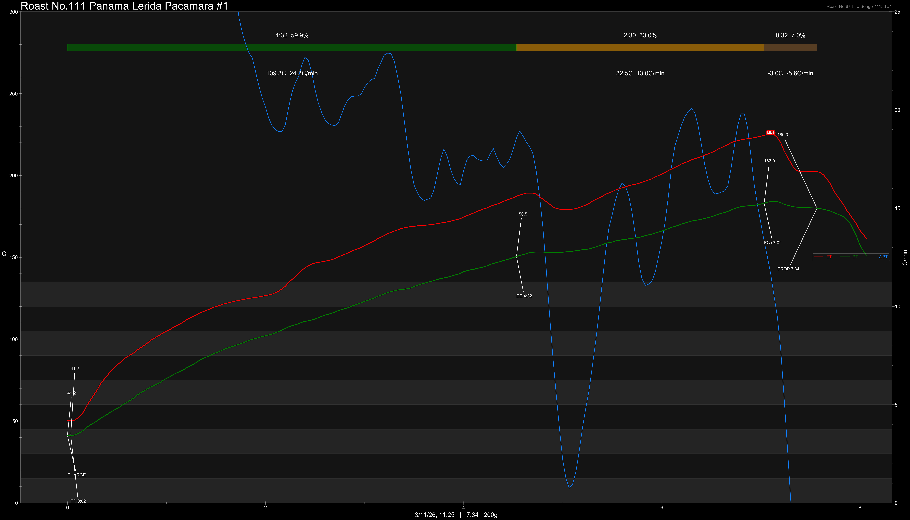

# Panama Finca Lerida Michela Pacamara #0826 Cold Room Dry Natural

Origin: Panama

Region: Boquete

Farm / Station: Michela

Producers: Amoruso Family

Varietal: Pacamara

Process: Cold Room Dry Natural

Elevation (MASL): 1600

Stock: 800g

Lot: 0826

## Importer Information

Green Profile: Tangerines, Chocolate, Vanilla

Moisture: -

Density: -

Season Year: 2026

Pricing Transparency (SGD):

    - Green Price: $84.30/KG
    - 9% GST: $7.96
    - Shipping: $7.03 (Air)

Importer: [品力非](https://shop286243613.m.taobao.com/)

---

## Roast #1 3/11/2026

Weight Loss: 11%

QC3 Profile: mandarin orange, milk chocolate, pear

## Roast #2 x/x/2026

Weight Loss: %

QC3 Profile:

## Roast #3 x/x/2026

Weight Loss: %

QC3 Profile:

## Roast #4 x/x/2026

Weight Loss: %

QC3 Profile:

## Roast #5 x/x/2026

Weight Loss: %

QC3 Profile:

