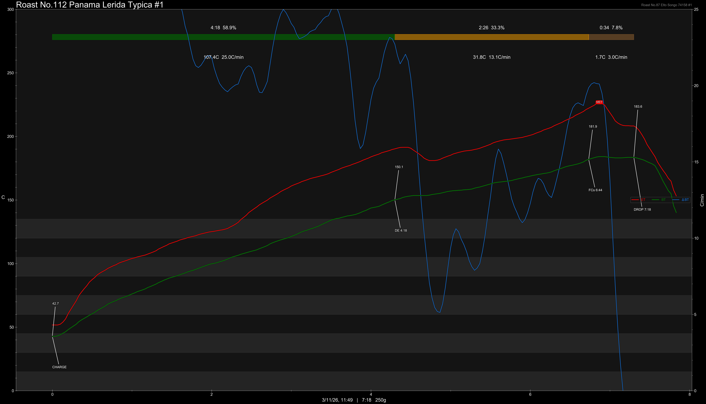

# Panama Finca Lerida Michela Typica #0796 Oxidation Natural

Origin: Panama

Region: Boquete

Farm / Station: Michela

Producers: Amoruso Family

Varietal: Typica

Process: Oxidation Natural

Elevation (MASL): 1600

Stock: 250g

Lot: 0796

## Importer Information

Green Profile: Guava, Pineapple, Honey

Moisture: -

Density: -

Season Year: 2026

Pricing Transparency (SGD):

    - Green Price: $29.55/500g
    - 9% GST: $2.79
    - Shipping: $2.46 (Air)

Importer: [品力非](https://shop286243613.m.taobao.com/)

---

## Roast #1 3/11/2026

Weight Loss: 9.2%

QC3 Profile: guava, grape, red tea

## Roast #2 x/x/2026

Weight Loss: %

QC3 Profile:

